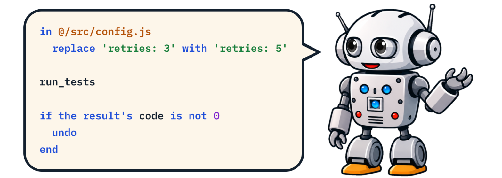

# Clank*Talk*

ClankTalk is a scripting language for agents to write and humans to read.  It replaces shell.

It's an [xTalk](https://en.wikipedia.org/wiki/HyperTalk) language, so it reads like English.  You might not want to *write* code that way, but then your agent is the one writing it, not you.  

You just have to read it.

With no shell and the ClankTalk runtime, you get a lot more control: file access stays inside your project, programs run only through tools you define (in an OS sandbox, if you like), and your agent can use secrets without seeing them.  

The runtime supports hooks, taint tracking, an audit log and an undo stack.

## Install

ClankTalk runs as an [MCP](https://modelcontextprotocol.io) server and requires Node 22 or higher.

Claude Code:

```bash
claude mcp add clank-talk -- npx -y -p clank-talk@0.1 clank-talk-mcp
```

Then, in Claude Code, add the plugin. It gives you `/taint`, `/clank-talk on|off`, and ClankTalk's questions in Claude Code's own dialog. In a project with an `AGENTS.talk`, it blocks the other tools:

```
/plugin install clank-talk --marketplace bigskysoftware/clank-talk
```

pi:

```bash
# install for this project only (without -l, every pi session on your machine gets it)
# in a project with an AGENTS.talk, clank-talk is the only tool; /clank-talk off turns that off
pi install -l git:github.com/bigskysoftware/clank-talk

# run pi once without any extensions, ClankTalk included
pi -ne

# turn ClankTalk on or off for this project
pi config --local

# remove it from this project
pi remove -l git:github.com/bigskysoftware/clank-talk
```

opencode (experimental, V2 only): install the package in your project, then load its plugin in `opencode.jsonc`:

```bash
npm install --save-dev clank-talk
```

```json
{ "plugins": ["./node_modules/clank-talk/src/js/harnesses/opencode"] }
```

Codex:

```bash
codex mcp add clank-talk -- npx -y -p clank-talk@0.1 clank-talk-mcp
codex mcp list
```

Other MCP clients, such as Cursor (`.cursor/mcp.json` in your project), take a config like this.  The [install docs](https://clank.talk/docs.html#install) show more.

```json
{
  "mcpServers": {
    "clank-talk": {
      "command": "npx",
      "args": ["-y", "-p", "clank-talk@0.1", "clank-talk-mcp"]
    }
  }
}
```

## Docs

- [Docs for humans](https://clank.talk/docs.html)
- [Docs for agents](https://clank.talk/reference.html)

## Contributing

Pull requests are open to collaborators only for now. 

Please open an [issue](https://github.com/bigskysoftware/clank-talk/issues) for bugs and ideas.

## Sponsor

ClankTalk is made by [Big Sky Software](https://github.com/bigskysoftware). 

To support the work, [sponsor us on GitHub](https://github.com/sponsors/bigskysoftware).

## License

[BSD-3-Clause](LICENSE)
